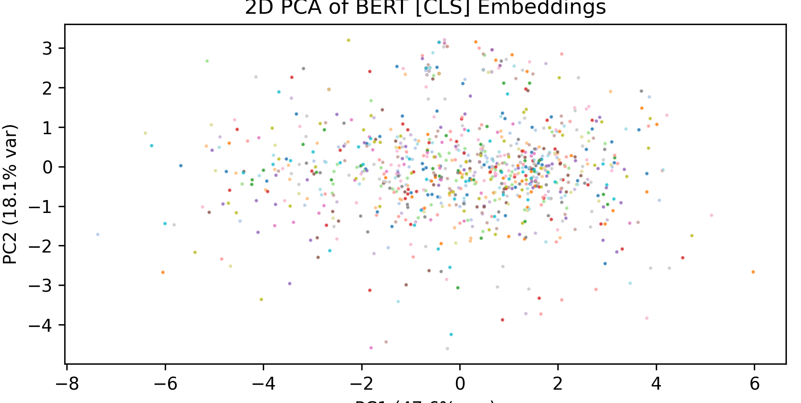
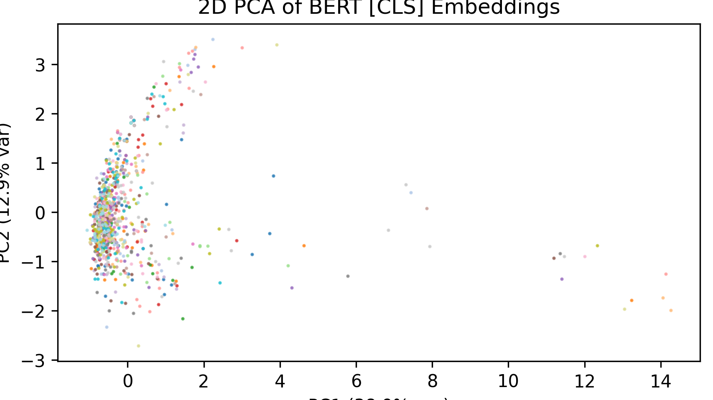
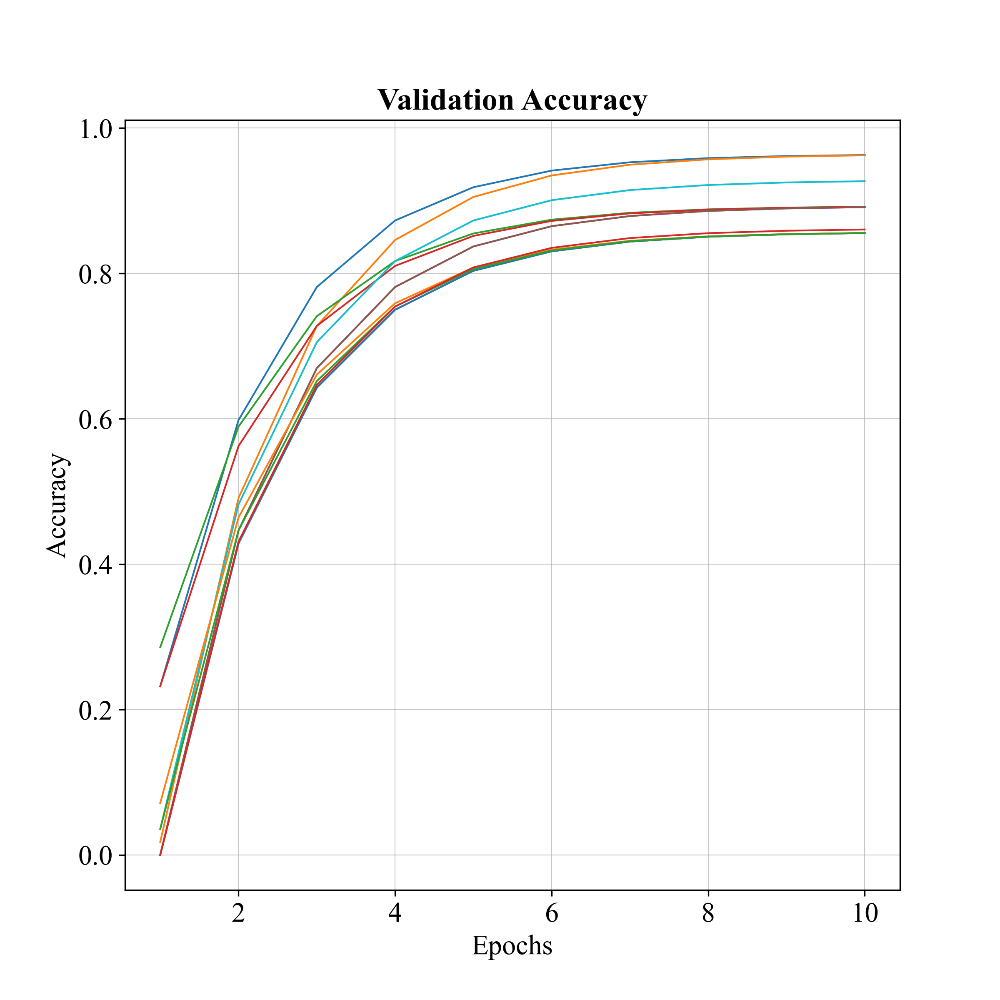
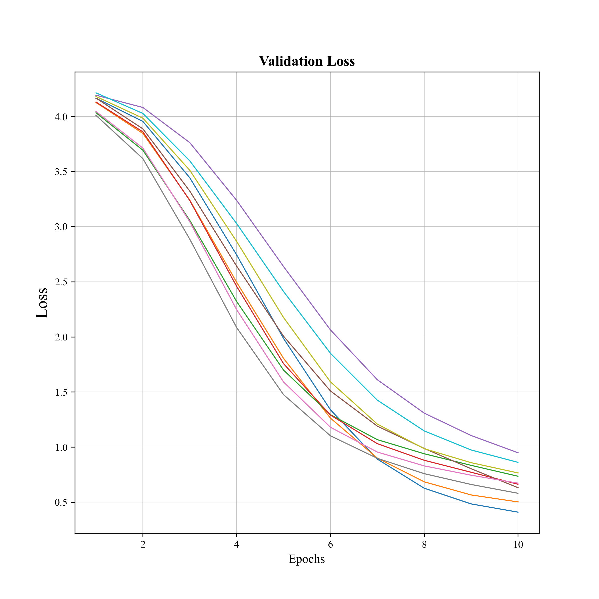
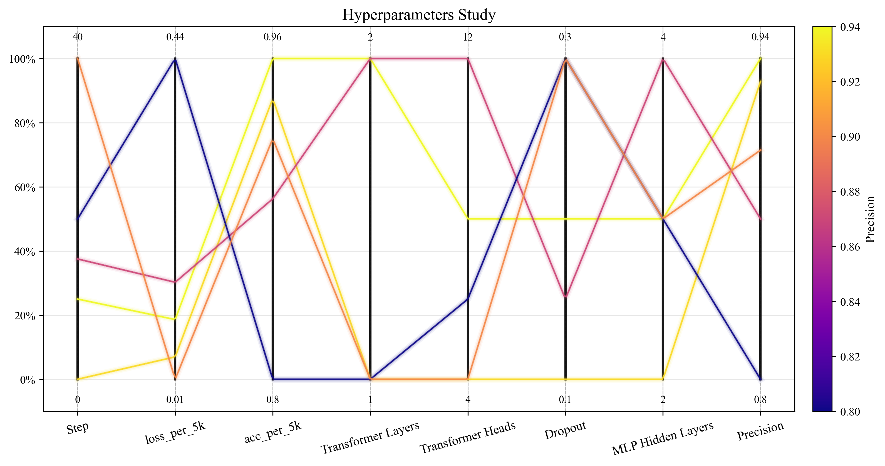

# Transformer-based Framework for Mapping Client Requirements to BIM

[](https://doi.org/10.1016/j.autcon.2025.106601)


Code, dataset samples and model resources for *Transformer-based framework for mapping client requirements to BIM*, published in *Automation in Construction* (vol. 181, art. 106601, 2026). A fine-tuned BERT classifier maps free-text office-building requirements to BIM model codes, so that matching IFC models can be retrieved during early design.

- [Paper (ScienceDirect)](https://www.sciencedirect.com/science/article/pii/S0926580525006417)
- [Open-access copy (Zenodo)](https://zenodo.org/records/17345735)
- [Project page](https://italab.github.io/client-to-bim/)
- [Author website](https://quantumnovice.github.io/)
- [Model on Hugging Face](https://huggingface.co/ZappyKirby/client-to-bim/tree/main)
- [M3 Systems demo](https://m3systems.co.kr/home)

## Tech Stack

<div align="center">


[](https://skillicons.dev)

</div>

## Hugging Face Model

[](https://huggingface.co/ZappyKirby/client-to-bim/tree/main)

## Updates

- May 2026: Releasing full codebase and sample dataset
- January 2026: Paper published
- July 2025: Pretraining, Training and Validation

## Introduction

Client briefs reach architects as emails, meeting notes and word-processed documents, not as IFC classes or Revit family names. Interpreting them by hand slows early design and introduces inconsistency. This repository accompanies a framework that fine-tunes BERT on paired text descriptions and BIM model codes, so that a natural-language requirement is classified to the matching parametric office-building model. English, Korean and multilingual variants are provided.

## Effect of Pretraining on Model Performance

<table>
  <tr>
    <td>
      
    </td>
    <td>
      
    </td>
  </tr>
</table>

## Audio Summary

[Listen to audio summary on Github](assets/summary.wav)

## Pipeline


## Experiments

- Corpus: 40 office-building BIM models with more than 30,000 textual descriptions (expert-written and augmented)
- Classes balanced by random undersampling; k-fold validation
- Metrics: accuracy, precision, recall, F1-score

<table>
  <tr>
    <td>
      
    </td>
    <td>
      
    </td>
  </tr>
</table>

## Hyperparameter Tuning



## Results

<table>
<tr>
  <td>

### ML-Architecture Results

| Model                      | F-1 Score |
| -------------------------- | --------- |
| BERT Baseline              | 87%       |
| BERT Pretrained + Baseline | 95%       |
| BERT Pretrained + Our      | 96%       |

  </td>
  <td style="padding-left:40px">

### Pretraining Results

| Model           | F-1 Score |
| --------------- | --------- |
| BERT English    | 91%       |
| BERT Korean     | 89%       |
| BERT Multilingual | 90%       |

  </td>
</tr>
</table>
## Applications

- Office design automation
- Early-stage design analysis
- Requirements compliance validation

## Setup

### Prerequisites

Install the CUDA toolkit following the instructions for your platform.
We recommend using `conda` to install `cudatoolkit`.


[](https://anaconda.org/conda-forge/cudatoolkit)

Install the matching PyTorch build from the link below (CUDA 12.6 with the latest PyTorch is recommended).

[](https://pytorch.org/get-started/locally/)

### Running the source

```sh
git clone https://github.com/ITalab/client-to-bim
```

Install requirements

```sh
pip install -r requirements.txt
```

Conda


```sh
conda env create -f environment.yml
conda activate client-to-bim
```

Poetry


```sh
curl -sSL https://install.python-poetry.org | python3 -
```

```sh
poetry install
poetry shell
```

## Dataset Overview

Each entry in this dataset is organized by **class name** followed by a list of **text samples**. The structure is designed for easy parsing and use in NLP classification tasks.

### Description

- **Keys**: Represent class labels (e.g., `OCR`, `OUU`, `OBC`).
- **Values**: Lists of string texts associated with that class.

## Download Model

```python
from huggingface_hub import hf_hub_download

file_path = hf_hub_download(repo_id="ZappyKirby/client-to-bim", filename="model.safetensors")

```

or manually download weights from hugging face

[](https://huggingface.co/ZappyKirby/client-to-bim/tree/main)

## Training

### Pretrain

```sh
python mlm-pretrain.py
```

## Contributing

Contributions are welcome. See [contributing.md](contributing.md).

## Citation

```bib
@article{SHAH2026106601,
title = {Transformer-based framework for mapping client requirements to BIM},
journal = {Automation in Construction},
volume = {181},
pages = {106601},
year = {2026},
issn = {0926-5805},
doi = {10.1016/j.autcon.2025.106601},
note = {Open-access copy: https://zenodo.org/records/17345735},
url = {https://www.sciencedirect.com/science/article/pii/S0926580525006417},
author = {Syed Haseeb Shah and Saddiq Ur Rehman and Inhan Kim and Kyung-Eun Hwang},
keywords = {BIM, BERT, NLP, Recommendation, Office, Architecture, Design}
}
```
